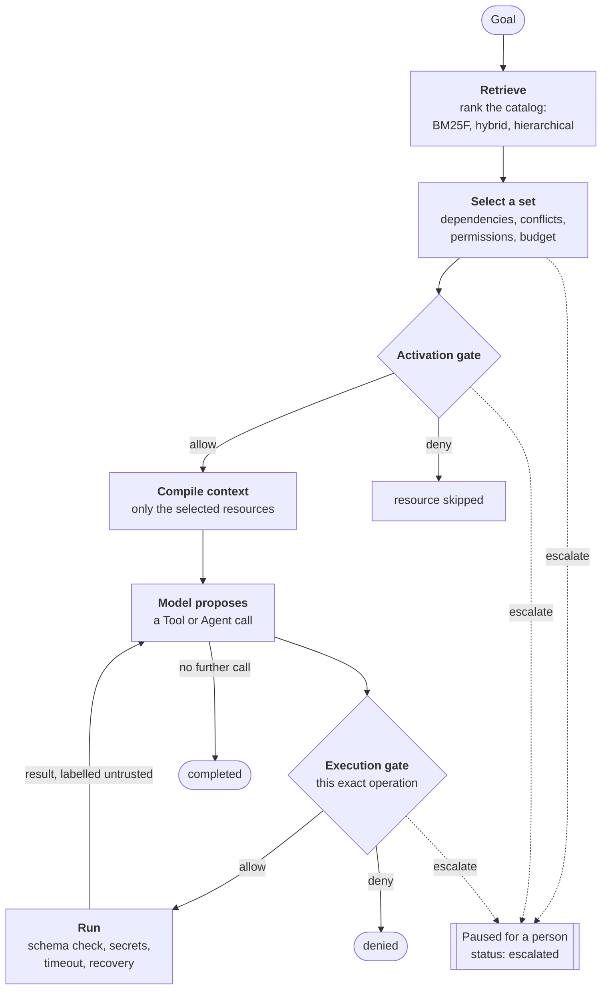
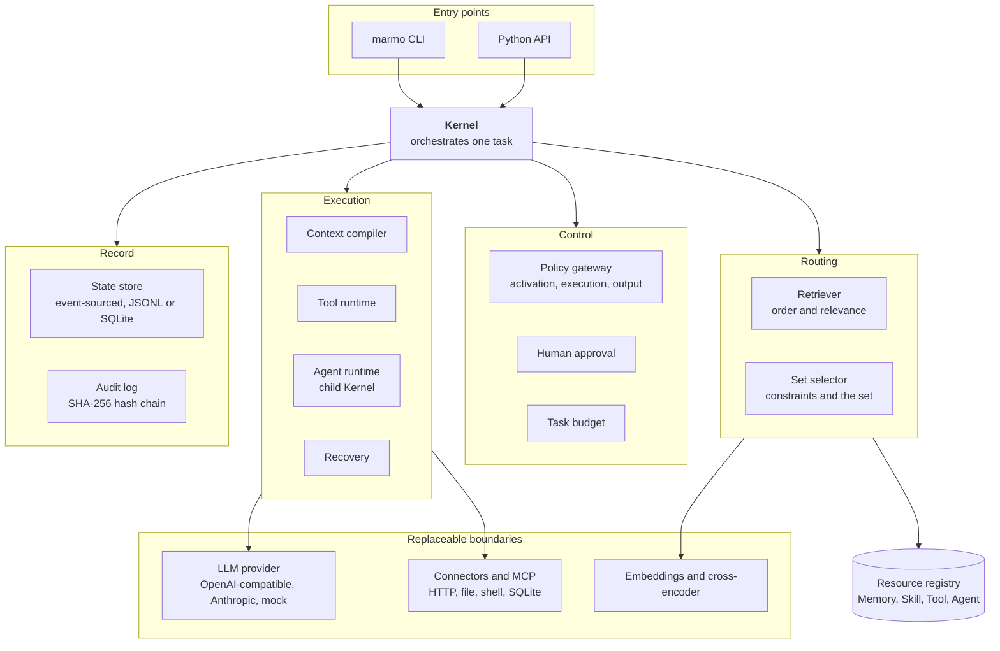
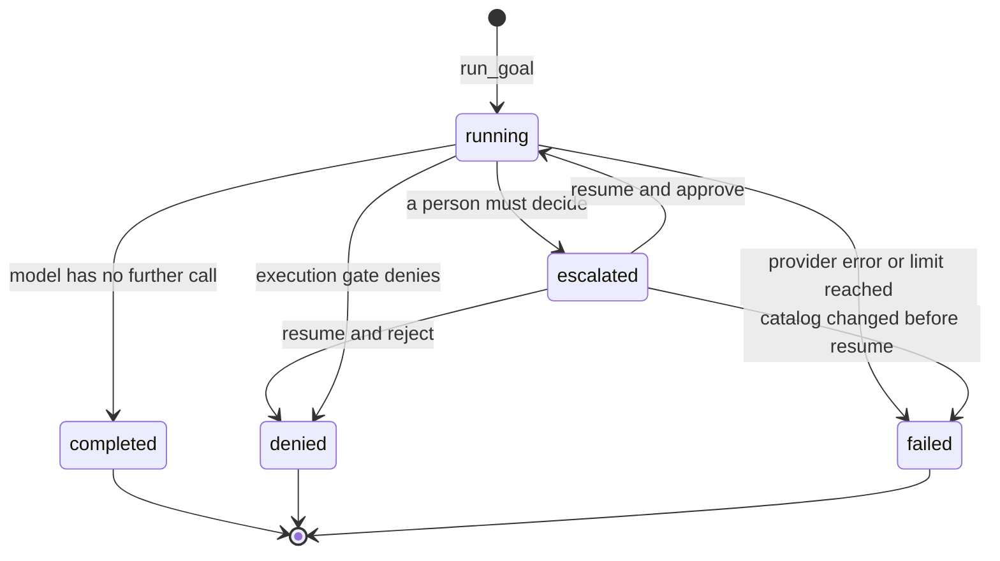
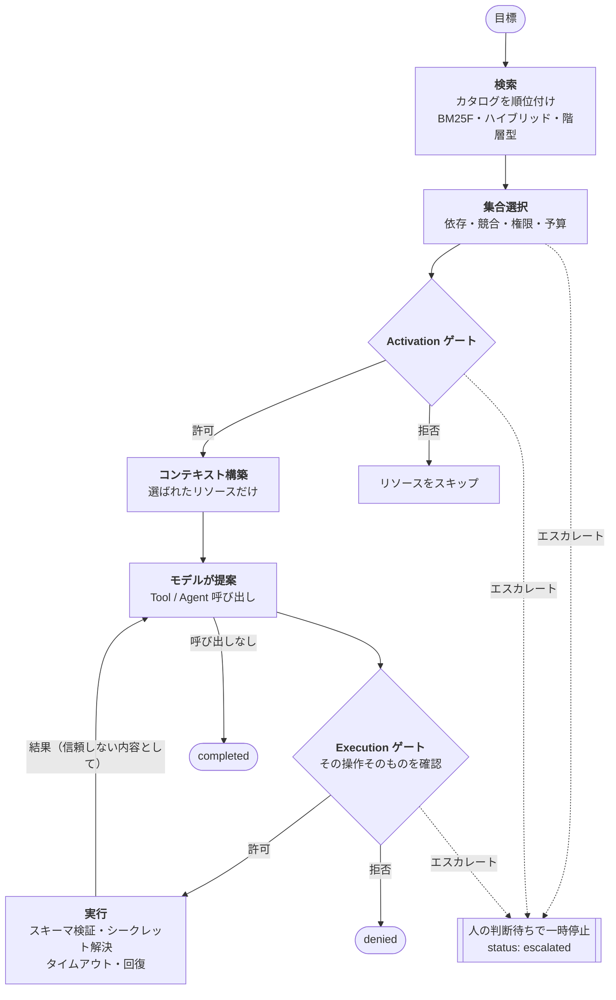
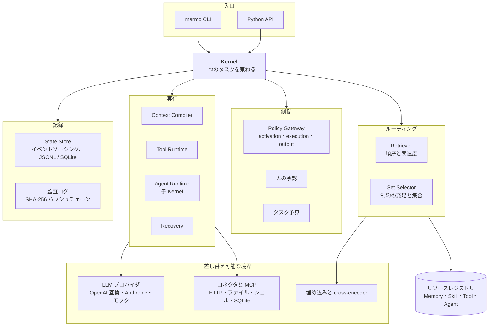
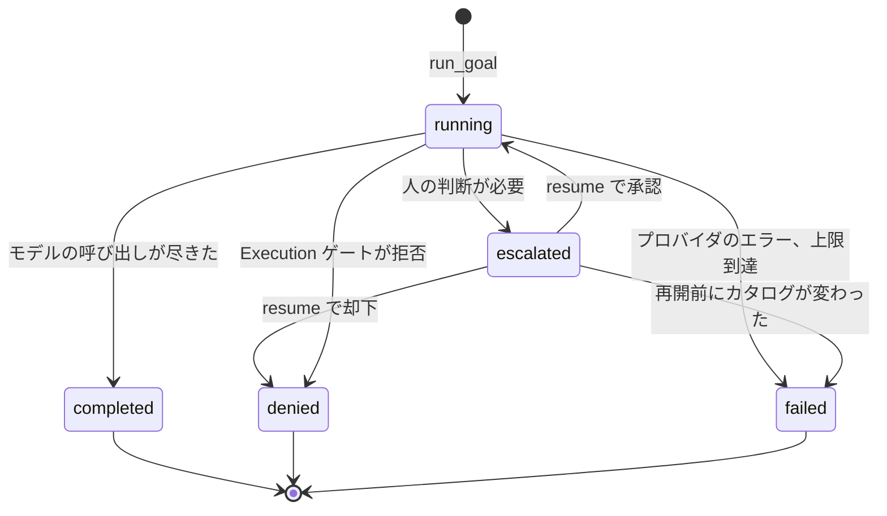

> 一番下に日本語版もあります

# Marmo-Core


[](https://pypi.org/project/marmo-core/)
[](https://pypi.org/project/marmo-core/)
[](https://github.com/kota-kawa/Marmo-Core/actions/workflows/ci.yml)
[](LICENSE)

Marmo-Core is a Python library and CLI for finding resources that fit an AI agent's goal and running them through permission and policy checks. It combines resource registration, search, selection, execution, human approval, and audit records in one kernel. Start offline with a deterministic mock model, then connect an OpenAI-compatible or Anthropic model.

**Overview:** [Why](#why-marmo-core) · [At a glance](#at-a-glance) · [How it works](#how-it-works) · [What it looks like](#what-it-looks-like) · [Safeguards](#safeguards) · [Design decisions](#design-decisions) · [Measured results](#measured-results) · [Lessons turned into guardrails](#lessons-turned-into-guardrails)

**Get started:** [Install](#install) · [Try it offline](#try-it-offline) · [Use a real model](#use-a-real-model) · [Execution notes](#execution-notes) · [Learn more](#learn-more-and-contribute)

## Why Marmo-Core

An agent with a thousand tools and skills cannot fit them all in its prompt. And the model that picks a tool should not also decide whether that tool is allowed to run. Marmo-Core answers the two questions separately:

- **Which resources fit this goal?** Search and set selection narrow a large catalog to the few resources the task needs, together with their dependencies. On a 1,000-resource catalog the model receives about 1,500 tokens of resource metadata instead of about 224,000.
- **May this exact operation run?** A tool call from the model is a proposal. Policy gates check it against the granted permissions, allowed side effects, trust level, and isolation level before anything executes, and they can pause the task for a person.

Each step of a task is appended to a hash-chained audit log and an event-sourced state store, so a paused task can be resumed and a finished one can be verified.

### What it manages

| Resource | Purpose |
| --- | --- |
| Memory | Information added to the agent's context. |
| Skill | Instructions the agent can use for a task. |
| Tool | A callable operation with a declared input schema and permissions. |
| Agent | A task delegated to another execution boundary. |

For each goal, the kernel searches a registry, selects resources, checks policy before activation and execution, calls the model, and records the outcome. Tools and Agents can be denied or paused for human approval. The [threat model](docs/threat-model.md) describes the security boundaries and their limits.

## At a glance

| | |
| --- | --- |
| **1 runtime dependency** | `python-dotenv`. HTTP uses `urllib`, and persistence uses JSONL files and `sqlite3` from the standard library. |
| **600+ unit tests** | Run in CI on Python 3.10 to 3.14 with `ResourceWarning` treated as an error. Provider responses are replayed through an injectable transport, so the suite needs no API key. |
| **99.3% less context** | 223,775 tokens of whole-catalog metadata against 1,472 tokens for the routed top 5, measured on 1,000 resources. |
| **7 ms search** | Mean warm latency of the pure-Python BM25F retriever over 1,000 resources (p95 15 ms). |
| **14 extension points** | Retriever, set selector, LLM, embeddings, policy, human approval, planner, state store, and others can be replaced without changing the kernel. |
| **11 decision records** | Each major design choice is written down with the alternatives that were rejected. |

The figures come from the result files committed under `benchmarks/results/`. Latency depends on the machine.

## How it works

### One goal, one guarded path



1. **Retrieve.** A retriever ranks the registry against the goal. The default is an offline BM25F index; hybrid (embeddings), hierarchical, graph, and LLM-assisted retrievers are available.
2. **Select a set.** A selector turns the ranked list into a set. It can return `selected`, `abstain`, or `escalate`, so "nothing fits" and "a person must grant this" are answers of their own.
3. **Gate, then compile.** Each selected resource passes the activation gate. Only what passes is compiled into the model's context.
4. **Propose, gate, run.** The model proposes a call. The execution gate checks that exact operation, then the runtime validates the arguments, resolves secrets, and runs it. The result returns to the model marked as untrusted content.
5. **Record.** Every step is written to the audit log and the state store.

### Layers



The kernel holds no algorithms of its own. Retrieval decides order and relevance, selection decides the set, and the gates decide whether an operation may run. Each of these is an interface passed to `Kernel(...)`, which is how new routing methods are tried without touching the default behaviour. [ARCHITECTURE.md](ARCHITECTURE.md) lists every module and extension point.

### Task lifecycle



A paused task is stored on disk with the resources it selected. `marmo resume` continues it from the saved conversation frame, so calls that already ran do not run again.

## What it looks like

Marmo-Core is a library and a CLI, so its screen is a terminal. The output below is copied from real runs with the offline mock model.

**Search** shows the score, the reason for each match, and the set that would be selected:

```text
$ marmo search examples/resources --task "read a local text file safely"
score  id                            version  kind   trust  effect  reason
-----  ----------------------------  -------  -----  -----  ------  -------------------------------------------------------------------
0.756  tool.files.read-text          1.0.0    tool   core   read    matched task terms: file, local, read, text; missing permissions...
0.484  skill.security.safe-tool-use  1.0.0    skill  core   none    matched task terms: read; requires no permissions; trust=core;...

Selected set:
  reason: selected top-ranked resources per kind after active filters: memory=0/1, skill=1/1, tool=1/3, agent=0/1
  - tool: tool.files.read-text@1.0.0 (0.756)
  - skill: skill.security.safe-tool-use@1.0.0 (0.484)
```

**A write is paused for approval.** The permission is granted, but a `write` side effect still needs a person. The task stops with exit code 1 and prints the command that answers it:

```text
$ marmo run resources/tools/write-text.json --task "write a note to a text file" \
    --tool-args '{"tool.marmo.samples.write-text":{"path":"note.txt","content":"hello"}}' \
    --granted-permission fs.write --state-dir state --audit-log audit.jsonl
task: 811757341812
status: escalated
detail: paused for human approval: activate tool.marmo.samples.write-text@1.0.0 (side_effect=write). Answer with Kernel.resume(task_id, HitlResponse(kind='approve')), or re-run with PolicyContext(human_approved=True) after a human review
awaiting confirmation:
[activation] activate tool Write Text (tool.marmo.samples.write-text@1.0.0)
  resource: tool.marmo.samples.write-text@1.0.0
  impact: side_effect=write, trust_level=verified, cost_estimate=0.02
  recommendation: reject
  alternative: reject to end the task
  alternative: skip tool.marmo.samples.write-text by narrowing the goal or the granted permissions
  answer with: marmo resume --task-id 811757341812 --state-dir state --approve --granted-permission fs.write --tool-args '{"tool.marmo.samples.write-text": {"content": "hello", "path": "note.txt"}}' --audit-log audit.jsonl resources/tools/write-text.json
audit: 4 records, last_hash=843d7fc95736ae5a…
```

**Approving resumes the same task** and extends the same audit chain:

```text
$ marmo resume --task-id 811757341812 --state-dir state --approve --granted-permission fs.write \
    --tool-args '{"tool.marmo.samples.write-text": {"content": "hello", "path": "note.txt"}}' \
    --audit-log audit.jsonl resources/tools/write-text.json
task: 811757341812
status: completed
output: Task complete. Tool tool.marmo.samples.write-text returned: {"bytes_written": 5, "path": "note.txt"}
  tool: tool.marmo.samples.write-text status=success elapsed_ms=1.7
audit: 13 records, last_hash=a0326675d8966969…
```

**The audit trail** of [`examples/hello_world.py`](examples/hello_world.py) lists one record per step, each hashed together with the one before it:

```text
$ python examples/hello_world.py
status: completed
output: Task complete. Tool tool.math.add returned: {"sum": 5}
audit trail:
  retrieve  d373216408c4f0d1…
  policy    bf3f8b7a4e53a266…
  activate  939efb9e32718b1b…
  compile   c5b23137dcffee34…
  llm       16c9922c3b46a1fd…
  execute   3956d62e303884fc…
  llm       4104fa9a58333d09…
  task      d5ab63a280463d4e…
audit hash chain verified.
```

## Safeguards

| Risk | What the kernel does |
| --- | --- |
| The model calls something it should not | A call is valid only for a resource activated for this task. The activation and execution gates check the exact operation against granted permissions, allowed side effects, trust level, and isolation level. |
| Instructions hidden in data | Memory bodies, file and web content, and Tool or Agent results are wrapped in a delimiter the payload cannot close. Once the model has read such content, a write, external, or irreversible call needs a human approval scoped to its arguments. |
| Secrets in prompts or logs | Tool arguments carry `{"$secret": ...}` references, resolved immediately before the handler runs. Error messages, audit records, and resume hints pass through one redaction module. |
| The same side effect running twice | A timed-out call is recorded as outcome unknown and is not retried or replaced automatically. A resumed task restores its saved conversation frame, so completed calls are not repeated. |
| An approved task running something else | A paused task stores the identity and content fingerprint of its selected resources. Resume fails if those resources or the compiled context changed. |
| Unbounded spend | With a `TaskBudget`, the kernel reserves cost before each model call and each Tool or Agent attempt, and stops further work when the ceiling is reached. |
| A delegated Agent seeing everything | A `structured_task` Agent runs in a child Kernel that holds only its declared dependencies and permissions. It shares the parent's budget and human approvals. |
| Tampered history | Audit records form a SHA-256 hash chain. `AuditLog.verify()` and `marmo resume` check the chain. |

These are in-process controls and they have limits: Tool handlers are not sandboxed, resource packages are not signed yet, and the prompt-injection detectors are deliberately incomplete. The [threat model](docs/threat-model.md) states the residual risk next to each control.

## Design decisions

Each row links to the decision record that holds the context and the rejected alternatives.

| Question | Choice | Rejected | Why |
| --- | --- | --- | --- |
| Runtime dependencies | One (`python-dotenv`). Model libraries stay behind provider interfaces and optional extras. | Adding dependencies without review | A kernel embedded in other applications should not constrain their dependency resolution. [ADR 0007](docs/decisions/0007-minimal-runtime-dependencies-with-user-approval.md) |
| Relevance scale | Absolute BM25F relevance: 1.0 means the document contains every query term once. Skill body text is weighted 0.25. | Dividing by the top score of each search | With relative scores every search had a high-scoring winner, so no abstain threshold could work. The cost was 2 of 120 scenarios losing first place to ties. [ADR 0003](docs/decisions/0003-absolute-relevance-and-bm25f.md) |
| Who solves set constraints | A solver over declared metadata: dependency closure, conflicts, permissions, budget. | Asking an LLM to choose the set, or taking the top result per kind | The top result per kind breaks dependency closure, and the LLM selects too little. [ADR 0005](docs/decisions/0005-constraints-solved-by-selector-not-llm.md) |
| Where permissions are enforced | In the selector, with the gates behind it. | Filtering at retrieval time | An early filter hides the cases a person could unblock. Abstain/escalate accuracy fell from 100% to 50%. [ADR 0005](docs/decisions/0005-constraints-solved-by-selector-not-llm.md) |
| Provider failure | The task ends as `failed` with a complete audit log and exit code 1. | Letting the exception propagate | Propagation left tasks `running` with no audit record after side effects had already happened. [ADR 0006](docs/decisions/0006-provider-failures-terminate-the-task.md) |
| Timeout | The outcome is unknown, so a person reconciles it. An optional process mode stops the handler on POSIX. | Abandoning the thread and retrying | A retry can repeat a write or a send. [ADR 0008](docs/decisions/0008-timeout-outcome-is-uncertain.md) |
| Budget | Reserve before each call and settle afterwards, in an append-only log. | Deducting once usage is known | Accounting after the fact can overshoot when calls run in parallel. [ADR 0009](docs/decisions/0009-task-budget-reservations.md) |
| Resume | Restore the saved selection and verify fingerprints. | Searching and selecting again | A second selection can change what the person approved. [ADR 0010](docs/decisions/0010-execution-snapshot.md) |
| Agent delegation | A child Kernel scoped to declared dependencies and permissions, on the parent's budget. | Passing the parent's whole registry, or giving each child its own budget | Least privilege, and nested delegation must not multiply the ceiling. [ADR 0011](docs/decisions/0011-agent-execution-backends-and-structured-tasks.md) |
| Research and stable code | New methods live on `research/*` branches and are evaluated from a separate repository at a pinned commit. | Developing methods on `main` | Published numbers stay tied to one commit, and `main` stays releasable. [ADR 0002](docs/decisions/0002-research-branches-and-frozen-sha.md) |

The Kernel's default selector is the simpler `RuleBasedSetSelector`. The constraint solvers (`GreedyConstrainedSetSelector`, `BeamSearchSetSelector`, `BranchAndBoundSetSelector`) are passed with `selector=`.

## Measured results

All numbers are read from the JSON files committed in `benchmarks/results/`. [benchmarks/README.md](benchmarks/README.md) has the full tables, the scenario design, and the negative results.

**Finding the right resource** (120 labelled goals, 1,000 third-party skills):

| | BM25F, no extra dependency | Hybrid with `bge-small` embeddings |
| --- | --- | --- |
| hit@1 / hit@5 | 65.0% / 76.7% | 76.7% / 86.7% |
| MRR | 0.694 | 0.810 |
| recall@50 | 90.8% | 98.3% |
| Warm latency, mean / p95 | 7.0 ms / 15.2 ms | 59.2 ms / 88.0 ms |

**Choosing a valid set** (28 goals with gold sets, 63 resources of all four kinds, hybrid retrieval):

| | Top result per kind | Greedy constraint solver | LLM selector (`gpt-4o-mini`) |
| --- | --- | --- | --- |
| Set F1 | 0.667 | **0.720** | 0.408 |
| Exact match | 0% | **62.5%** | 20.8% |
| Dependency closure | 0% | **100%** | 100% |
| Abstain/escalate accuracy | 0% | **100%** | 50% |

**Staying usable at scale** (synthetic catalogs with the same dependency structure):

| Catalog | Flat search | Namespace-hierarchical search |
| --- | --- | --- |
| 10,063 resources, hybrid | p50 1,036 ms, Set F1 0.550 | p50 24 ms, Set F1 0.589, scanning 0.95% of the catalog |
| 100,063 resources, lexical | p95 809 ms, Set F1 0.617 | p95 52 ms, Set F1 0.549 |

At 100,000 resources the hierarchy trades some accuracy for the latency gain. The 1,000-skill corpus is third-party material and is not redistributed, so the first table needs that corpus to reproduce; the other two run from files in this repository.

## Lessons turned into guardrails

Each of these failures happened in this project. The right column is the test, check, or rule that now keeps it from returning.

| What went wrong | Cause | What prevents it now |
| --- | --- | --- |
| 419 tests passed while every tool call failed against real providers with HTTP 400. | Tests used only a mock model. Resource ids contain dots, which provider tool-name grammars reject. | `ToolNameCodec` maps names both ways. `tests/test_provider_compat.py` checks the wire request against replayed provider responses, and a change to the wire format is also run against a real model when one is available. |
| A goal about ramen scored 0.63 and activated an AWS Step Functions skill. | Scores were divided by the top hit of each search, so every search had a confident winner. | Relevance is absolute ([ADR 0003](docs/decisions/0003-absolute-relevance-and-bm25f.md)). A scoring change must report set-selection coverage and abstain accuracy, not ranking alone. |
| `max_tool_calls=3` allowed up to 12 executions. | The limit counted model rounds, and the check ran before the counter moved. | Executed calls are counted before each run, and the count is saved in the task frame so a resume does not reset it. |
| A provider error left the task `running` with no audit log. | The exception escaped the kernel loop. | Provider errors end the task as `failed` and the audit log is still written ([ADR 0006](docs/decisions/0006-provider-failures-terminate-the-task.md)). |
| The printed resume command lost its permission flags. The approved tool was skipped and the run still exited 0. | The hint did not carry `--granted-permission` or `--allow-side-effect`. | The hint reproduces the original flags, and `--strict` fails a run in which no callable reached the model. |
| A key for another provider was sent to `api.openai.com`, and the 401 response echoed part of it. | The embedding endpoint was fixed, and redaction patterns lived in two places. | Chat and embeddings resolve the endpoint from the same setting. Redaction lives in one module, `marmo_core/secrets.py`, and covers provider error bodies. |
| Every statistics write rebuilt the index and called a paid embedding API again. | The cache key changed on any registry write. | Caches use `content_revision`, which moves only when searchable content changes. |

Fixes ship with a regression test that fails when the fix is reverted. The longer list is in [lessons from history](docs/knowledge/lessons_from_history.md).

Every pull request runs these checks in CI:

- The test suite on Python 3.10, 3.11, 3.12, 3.13, and 3.14, with `ResourceWarning` as an error
- `ruff` and `mypy`
- `scripts/release_check.py`: the version files and the changelog agree
- `scripts/check_doc_paths.py`: every path named in the documentation exists
- `scripts/check_env_documentation.py`: `.env.example` matches the environment variables the code reads
- `check-manifest`, a package build, `twine check`, and `check-wheel-contents`
- A Docker build that runs the tests inside the image

Frozen fixtures in `tests/fixtures/compat/v0.3.0/` fail the suite if a public name is removed.

## Install

Requires **Python 3.10 or newer**.

```bash
python -m pip install marmo-core
```

The `marmo` CLI and Python API are installed together. No API key is needed for the offline examples below.

## Try it offline

### Python: run one Tool

This complete example registers an addition Tool, grants its declared permission, and runs a goal with the mock model. The model's arguments are fixed so the result is reproducible.

```python
from marmo_core import (
    Kernel, MockLLMProvider, PolicyContext, ResourceDefinition, ResourceRegistry,
)


def add_numbers(a: float, b: float) -> dict:
    return {"sum": a + b}


registry = ResourceRegistry()
registry.add(ResourceDefinition.from_mapping({
    "id": "tool.math.add", "kind": "tool", "name": "Add Numbers", "version": "1.0.0",
    "description": "Add two numbers and return their sum.",
    "capabilities": ["arithmetic"], "input_summary": "Two numbers a and b.",
    "output_summary": "Object with the sum.", "required_permissions": ["math.add"],
    "cost_estimate": 0.0, "latency_class": "fast", "side_effect": "none",
    "trust_level": "core", "ref": "tool://math/add", "tags": ["math"],
    "input_schema": {"type": "object", "required": ["a", "b"],
                     "properties": {"a": {"type": "number"}, "b": {"type": "number"}}},
}))

kernel = Kernel(
    registry,
    MockLLMProvider(tool_arguments={"tool.math.add": {"a": 2, "b": 3}}),
    policy_context=PolicyContext(granted_permissions=("math.add",)),
    tool_implementations={"tool.math.add": add_numbers},
)
result = kernel.run_goal("Add 2 and 3 with the calculator tool")
print(result.status, result.output)
```

The status is `completed`, and the Tool result contains `{"sum": 5}`. For a runnable file that also prints and verifies the audit trail, see [`examples/hello_world.py`](examples/hello_world.py).

### CLI: inspect and run a bundled example

The resource files in these commands live in this repository. Clone it first if you installed only the PyPI package:

```bash
git clone https://github.com/kota-kawa/Marmo-Core.git
cd Marmo-Core
marmo validate examples/resources
marmo search examples/resources --task "read a local text file safely"
```

Run the bundled JSON validation Tool without a model account or manual Python binding:

```bash
marmo run resources/tools/validate-json.json \
  --task "validate JSON input" \
  --tool-args '{"tool.marmo.samples.validate-json":{"value":{"name":"Marmo"},"schema":{"type":"object","required":["name"],"properties":{"name":{"type":"string"}}}}}' \
  --strict --format json
```

`--tool-args` supplies calls to the mock model; it does not ask a model to choose arguments. The repository also includes ten samples each of Memory, Tool, and Agent resources under `resources/`. The Tool and Agent samples have executable handlers.

## Use a real model

Create a `.env` file in your working directory, or set the same variables in your shell. In a source checkout, start from the template:

```bash
cp .env.example .env
```

| Provider | Required environment variables |
| --- | --- |
| OpenAI-compatible | `OPENAI_API_KEY`, `OPENAI_MODEL` |
| Anthropic | `ANTHROPIC_API_KEY`, `ANTHROPIC_MODEL`, `ANTHROPIC_MAX_TOKENS` |

The model name and maximum token setting can instead be passed to the corresponding Python provider constructor. `OPENAI_BASE_URL` selects another OpenAI-compatible endpoint; leave it empty for `api.openai.com`. `OPENAI_REASONING_EFFORT` is optional and provider-specific. See [`.env.example`](.env.example) for the full configuration and examples. OS environment variables take precedence over `.env` values.

From the repository checkout, ask an OpenAI-compatible model to select file Tools:

```bash
marmo run resources/tools \
  --llm openai \
  --task "List the text files in the current directory, then read each one and tell me what they say" \
  --granted-permission fs.read \
  --allow-side-effect none --allow-side-effect read
```

Use `--llm anthropic` for Anthropic. With a real model, `--tool-args` is ignored: the model chooses the Tool and its arguments. The default lexical retriever matches resources against their English metadata. For a goal in another language, add `--retriever hyde`; it uses the selected real model to restate the goal in that vocabulary before retrieval.

The equivalent Python setup is:

```python
from marmo_core import HydeRetriever, Kernel, LexicalRetriever, OpenAICompatibleLLMProvider, load_registry

llm = OpenAICompatibleLLMProvider()
kernel = Kernel(load_registry(["resources/tools"]), llm, retriever=HydeRetriever(llm, LexicalRetriever()))
```

To set one cost ceiling for a Python task, pass an explicit currency and model price. Resource `cost_estimate` values must use the same currency:

```python
from decimal import Decimal
from marmo_core import Kernel, ModelPrice, OpenAICompatibleLLMProvider, TaskBudget, load_registry

budget = TaskBudget(
    amount=Decimal("1.00"),
    currency="USD",
    resource_cost_unit="USD",
    model_price=ModelPrice(
        input_per_million=Decimal("0.50"),
        output_per_million=Decimal("2.00"),
        max_input_tokens=4000,
        max_output_tokens=1000,
    ),
)
kernel = Kernel(load_registry(["resources/tools"]), OpenAICompatibleLLMProvider(), task_budget=budget)
result = kernel.run_goal("Summarize the report")
print(kernel.budget_status(result.task_id))
```

The budget covers calls made through the Kernel and declared Resource estimates. Include any paid service a Tool or Agent calls in its estimate. Each model request receives the configured output-token ceiling, and the input-token ceiling is checked against an estimate of the serialized messages and tool schemas. Reported usage above either ceiling is recorded and stops further work; input estimation and provider usage reporting can still make actual charges exceed the reservation. A custom `LLMProvider` must implement `complete_bounded()` and set `supports_output_token_limit` to `True` to be used with a task budget. Resume with the same `TaskBudget` and state store.

## Execution notes

- `--granted-permission` and `--allow-side-effect` control separate checks. The latter is a repeatable exact allowlist: permitting both no side effect and reads requires both values as shown above.
- `marmo run` uses the mock model by default. A skipped resource can be recoverable; use `--strict` in automation to fail when a resource is skipped, a Tool named in `--tool-args` is not evaluated, or retrieval finds no usable resource.
- On POSIX systems, `--timeout-mode process` stops importable Python Tool handlers with JSON-compatible inputs and outputs at the deadline. Local closures are rejected in this mode; Windows rejects process mode because child-process termination cannot be guaranteed. The default `thread` mode limits waiting but cannot stop a timed-out handler. A timeout requires human reconciliation before retry because an external effect may have completed.
- A paused task saves its selected resources. Resume keeps that set; if a selected resource or compiled context changed, the task fails and must be resumed with the original catalog and compiler configuration.
- Agent Cards can use `tool_wrap` for a guarded local handler or `structured_task` for a child Kernel. A `structured_task` card requires a string `goal` and declares its available resources through transitive `metadata.dependencies`; the child receives only the Agent's declared permissions and shares the parent task budget and human approvals. The default `max_agent_depth=1` permits an Agent to use Tools; set a higher value to allow nested Agent calls.
- A Tool argument that misses its `input_schema` can be returned to a real model for correction. `--max-input-repairs` defaults to 2. Tool output sent to the model is capped at an estimated 8,000 tokens by default (`--max-tool-output-tokens`).
- CLI commands discover `resources`, `skills`, or `examples/resources` in the current directory when no path is given. For a connector-only run, use `--no-default-resources`.
- Bundled filesystem examples operate within the current working directory. External examples require their declared permissions and human approval. The notification example reads `MARMO_NOTIFICATION_<DESTINATION>_URL` from the environment, and the `format-code` example requires the `.[dev]` extra for Ruff.

Run `marmo --help` or `marmo run --help` for all CLI options.

## Learn more and contribute

| Guide | Contents |
| --- | --- |
| [Project website](https://project-kk.com/en/marmo) | Library overview, concepts, and usage guide. |
| [Architecture](ARCHITECTURE.md) | Layers, the request path, contracts, and extension points. |
| [Decision records](docs/decisions/README.md) | Design choices and the alternatives that were rejected. |
| [Threat model](docs/threat-model.md) | Trust boundaries, controls, and residual risks. |
| [Benchmarks](benchmarks/README.md) | Routing evaluation and committed results. |
| [Built-in Connectors](docs/connectors.md) | Connector setup and usage. |
| [Local Resource Packages](docs/local-resource-packages.md) | Packaging and loading local resources. |
| [Contributing](CONTRIBUTING.md) | Development setup, checks, and pull requests. |
| [Changelog](CHANGELOG.md) | Released and upcoming changes. |

For a bug report or feature request, use [GitHub Issues](https://github.com/kota-kawa/Marmo-Core/issues). Marmo-Core is distributed under the [Apache License 2.0](LICENSE).

<details>
<summary>日本語版 (クリックして展開)</summary>

## Marmo-Core とは

Marmo-Core は、AI エージェントの目標に合うリソースを探し、権限とポリシーを確認して実行するための Python ライブラリと CLI です。リソースの登録、検索、選択、実行、人による承認、監査記録を一つのカーネルにまとめます。まずは決定的なモックモデルでオフライン実行を試し、その後 OpenAI 互換または Anthropic のモデルに接続できます。

**概要:** [作った理由](#作った理由) · [数字で見る](#数字で見る) · [仕組み](#仕組み) · [画面](#画面) · [安全のための仕組み](#安全のための仕組み) · [技術選定](#技術選定) · [測定結果](#測定結果) · [再発防止](#再発防止)

**使い始める:** [インストール](#インストール) · [オフラインで試す](#オフラインで試す) · [実モデルを使う](#実モデルを使う) · [実行時の注意](#実行時の注意) · [詳しい資料](#詳しい資料と貢献)

### 作った理由

Tool や Skill が千件あるエージェントは、その全部をプロンプトに載せられません。また、Tool を選ぶモデル自身に「その Tool を実行してよいか」まで決めさせるべきでもありません。Marmo-Core はこの二つの問いを分けて扱います。

- **この目標に合うリソースはどれか。** 検索と集合選択で、大きなカタログからタスクに必要な少数のリソースと、その依存先を選びます。1,000 件のカタログでは、モデルに渡すリソースのメタデータが約 224,000 トークンから約 1,500 トークンになります。
- **この操作を実行してよいか。** モデルが返す Tool 呼び出しは提案として扱います。実行の前に、付与された権限、許可された副作用、信頼レベル、隔離レベルをポリシーゲートが確認し、必要なら人の承認を待ってタスクを一時停止します。

タスクの各ステップは、ハッシュチェーン付きの監査ログとイベントソーシングの状態ストアに追記されます。そのため、一時停止したタスクは再開でき、終了したタスクは後から検証できます。

#### 扱うリソース

| 種類 | 役割 |
| --- | --- |
| Memory | エージェントの文脈に加える情報。 |
| Skill | タスクで利用する手順や指示。 |
| Tool | 入力スキーマと必要な権限を宣言した呼び出し可能な処理。 |
| Agent | 別の実行境界で委任するタスク。 |

カーネルは目標ごとに登録済みリソースを検索・選択し、有効化と実行の前にポリシーを確認します。Tool と Agent は拒否されたり、人の承認待ちになったりします。保護の対象と限界は[脅威モデル](docs/threat-model.md)を参照してください。

### 数字で見る

| | |
| --- | --- |
| **実行時依存 1 つ** | `python-dotenv` のみ。HTTP は `urllib`、永続化は JSONL ファイルと標準ライブラリの `sqlite3` を使います。 |
| **600 件以上の単体テスト** | CI が Python 3.10〜3.14 で実行し、`ResourceWarning` もエラーとして扱います。プロバイダの応答は差し替え可能な transport で再生するため、API キーなしで通ります。 |
| **文脈を 99.3% 削減** | カタログ全体のメタデータ 223,775 トークンに対し、ルーティング後の上位 5 件は 1,472 トークン（1,000 件で測定）。 |
| **検索 7 ms** | 純 Python の BM25F 検索を 1,000 件に対して実行したときのウォーム時平均（p95 は 15 ms）。 |
| **拡張点 14 か所** | Retriever、Set Selector、LLM、埋め込み、ポリシー、人の承認、Planner、状態ストアなどを、カーネルを変えずに差し替えられます。 |
| **技術判断の記録 11 件** | 主要な設計判断を、採らなかった代替案と一緒に残しています。 |

数値は `benchmarks/results/` にコミットした結果ファイルから取っています。レイテンシは測定機によって変わります。

### 仕組み

#### 一つの目標がたどる経路



1. **検索。** Retriever が目標に対してレジストリを順位付けします。既定はオフラインで動く BM25F 索引で、埋め込みを併用するハイブリッド、階層型、グラフ拡張、LLM 支援の Retriever も選べます。
2. **集合選択。** Selector が順位付きの候補から集合を作ります。結果は `selected`、`abstain`、`escalate` のいずれかで、「合うものが無い」「人が権限を与えれば実行できる」も答えとして返せます。
3. **ゲートを通してから文脈を作る。** 選ばれたリソースはそれぞれ Activation ゲートを通ります。通ったものだけがモデルの文脈に入ります。
4. **提案、ゲート、実行。** モデルが呼び出しを提案し、Execution ゲートがその操作そのものを確認します。その後ランタイムが引数を検証し、シークレットを解決して実行します。結果は「信頼しない内容」の印を付けてモデルに戻します。
5. **記録。** すべてのステップを監査ログと状態ストアに書きます。

#### レイヤー構成



カーネル自身はアルゴリズムを持ちません。検索が順序と関連度を、選択が集合を、ゲートが実行の可否を決めます。いずれも `Kernel(...)` に渡すインターフェースなので、既定の挙動を変えずに新しいルーティング手法を試せます。全モジュールと拡張点は [ARCHITECTURE.md](ARCHITECTURE.md) にあります。

#### タスクの状態遷移



一時停止したタスクは、選択済みのリソースと一緒にディスクへ保存されます。`marmo resume` は保存済みの会話フレームから続行するため、実行済みの呼び出しをもう一度実行することはありません。

### 画面

Marmo-Core はライブラリと CLI なので、画面はターミナルです。以下はオフラインのモックモデルで実際に実行した出力です。

**検索**は、スコア、一致した理由、選択される集合を表示します。

```text
$ marmo search examples/resources --task "read a local text file safely"
score  id                            version  kind   trust  effect  reason
-----  ----------------------------  -------  -----  -----  ------  -------------------------------------------------------------------
0.756  tool.files.read-text          1.0.0    tool   core   read    matched task terms: file, local, read, text; missing permissions...
0.484  skill.security.safe-tool-use  1.0.0    skill  core   none    matched task terms: read; requires no permissions; trust=core;...

Selected set:
  reason: selected top-ranked resources per kind after active filters: memory=0/1, skill=1/1, tool=1/3, agent=0/1
  - tool: tool.files.read-text@1.0.0 (0.756)
  - skill: skill.security.safe-tool-use@1.0.0 (0.484)
```

**書き込みは承認待ちで止まります。** 権限は付与済みですが、副作用が `write` の操作には人の承認が要ります。タスクは終了コード 1 で停止し、回答するためのコマンドを表示します。

```text
$ marmo run resources/tools/write-text.json --task "write a note to a text file" \
    --tool-args '{"tool.marmo.samples.write-text":{"path":"note.txt","content":"hello"}}' \
    --granted-permission fs.write --state-dir state --audit-log audit.jsonl
task: 811757341812
status: escalated
detail: paused for human approval: activate tool.marmo.samples.write-text@1.0.0 (side_effect=write). Answer with Kernel.resume(task_id, HitlResponse(kind='approve')), or re-run with PolicyContext(human_approved=True) after a human review
awaiting confirmation:
[activation] activate tool Write Text (tool.marmo.samples.write-text@1.0.0)
  resource: tool.marmo.samples.write-text@1.0.0
  impact: side_effect=write, trust_level=verified, cost_estimate=0.02
  recommendation: reject
  alternative: reject to end the task
  alternative: skip tool.marmo.samples.write-text by narrowing the goal or the granted permissions
  answer with: marmo resume --task-id 811757341812 --state-dir state --approve --granted-permission fs.write --tool-args '{"tool.marmo.samples.write-text": {"content": "hello", "path": "note.txt"}}' --audit-log audit.jsonl resources/tools/write-text.json
audit: 4 records, last_hash=843d7fc95736ae5a…
```

**承認すると同じタスクが再開し**、同じ監査チェーンに続きが追記されます。

```text
$ marmo resume --task-id 811757341812 --state-dir state --approve --granted-permission fs.write \
    --tool-args '{"tool.marmo.samples.write-text": {"content": "hello", "path": "note.txt"}}' \
    --audit-log audit.jsonl resources/tools/write-text.json
task: 811757341812
status: completed
output: Task complete. Tool tool.marmo.samples.write-text returned: {"bytes_written": 5, "path": "note.txt"}
  tool: tool.marmo.samples.write-text status=success elapsed_ms=1.7
audit: 13 records, last_hash=a0326675d8966969…
```

[`examples/hello_world.py`](examples/hello_world.py) の**監査記録**は、ステップごとに 1 件ずつ並びます。各レコードは直前のレコードのハッシュを含めてハッシュ化されます。

```text
$ python examples/hello_world.py
status: completed
output: Task complete. Tool tool.math.add returned: {"sum": 5}
audit trail:
  retrieve  d373216408c4f0d1…
  policy    bf3f8b7a4e53a266…
  activate  939efb9e32718b1b…
  compile   c5b23137dcffee34…
  llm       16c9922c3b46a1fd…
  execute   3956d62e303884fc…
  llm       4104fa9a58333d09…
  task      d5ab63a280463d4e…
audit hash chain verified.
```

### 安全のための仕組み

| リスク | カーネルの対処 |
| --- | --- |
| モデルが呼ぶべきでないものを呼ぶ | 呼び出しが有効なのは、そのタスクで有効化されたリソースだけです。Activation と Execution の各ゲートが、付与された権限、許可された副作用、信頼レベル、隔離レベルに照らして操作そのものを確認します。 |
| データに紛れた指示 | Memory の本文、ファイルや Web の内容、Tool・Agent の結果は、中身からは閉じられない区切りで包みます。モデルがそうした内容を読んだ後の書き込み・外部送信・不可逆の呼び出しには、引数単位の人の承認が要ります。 |
| プロンプトやログへのシークレット混入 | Tool の引数には `{"$secret": ...}` の参照を渡し、ハンドラ実行の直前に解決します。エラーメッセージ、監査レコード、再開コマンドの案内は、一つの伏せ字モジュールを通します。 |
| 同じ副作用の二重実行 | タイムアウトした呼び出しは「結果不明」として記録し、自動での再試行や代替実行をしません。再開したタスクは保存済みの会話フレームを復元するので、完了済みの呼び出しを繰り返しません。 |
| 承認した内容と違うものが実行される | 一時停止したタスクは、選択したリソースの識別子と内容のフィンガープリントを保存します。リソースまたはコンパイル済みの文脈が変わっていれば、再開は失敗します。 |
| 際限のない費用 | `TaskBudget` を指定すると、モデル呼び出しと Tool・Agent の各試行の前に費用を予約し、上限に達したら以後の処理を止めます。 |
| 委任先の Agent に全部が見える | `structured_task` の Agent は、宣言した依存先と権限だけを持つ子 Kernel で動きます。予算と人の承認は親と共有します。 |
| 履歴の改ざん | 監査レコードは SHA-256 のハッシュチェーンになっています。`AuditLog.verify()` と `marmo resume` がチェーンを検証します。 |

これらはプロセス内の対策で、限界があります。Tool のハンドラはサンドボックス化されておらず、リソースパッケージの署名は未実装で、プロンプトインジェクションの検知は意図的に網羅していません。[脅威モデル](docs/threat-model.md)に、対策ごとの残るリスクを書いています。

### 技術選定

各行は、背景と採らなかった代替案を書いた判断記録（ADR）にリンクしています。

| 論点 | 採用 | 採らなかった案 | 理由 |
| --- | --- | --- | --- |
| 実行時依存 | 1 つ（`python-dotenv`）。モデル系のライブラリはプロバイダのインターフェースと optional extra の背後に置く。 | 確認なしに依存を追加する | 他のアプリケーションに組み込まれるカーネルが、組み込み先の依存解決を縛るべきではないため。[ADR 0007](docs/decisions/0007-minimal-runtime-dependencies-with-user-approval.md) |
| 関連度の尺度 | 絶対値の BM25F。クエリ語をすべて 1 回含む文書を 1.0 とし、Skill 本文の重みは 0.25。 | 検索ごとの最高点で割る相対正規化 | 相対値ではどの検索でも 1 位が高得点になり、棄権のしきい値が機能しなかった。代償として 120 件中 2 件が同点で 1 位から外れた。[ADR 0003](docs/decisions/0003-absolute-relevance-and-bm25f.md) |
| 集合の制約を誰が解くか | 宣言メタデータ（依存閉包、競合、権限、予算）に対するソルバー。 | LLM に集合を選ばせる／種別ごとの 1 位を取る | 種別ごとの 1 位は依存閉包を壊し、LLM は選ぶ数が足りない。[ADR 0005](docs/decisions/0005-constraints-solved-by-selector-not-llm.md) |
| 権限をどこで課すか | Selector の中。その後ろにゲートを置く。 | 検索時に絞り込む | 早い段階で絞ると「人が権限を与えれば実行できる」ケースが見えなくなる。abstain/escalate 精度が 100% から 50% に落ちた。[ADR 0005](docs/decisions/0005-constraints-solved-by-selector-not-llm.md) |
| プロバイダの失敗 | タスクを `failed` で終端し、監査ログを残す。終了コードは 1。 | 例外をそのまま伝播させる | 伝播させると、副作用が起きた後でもタスクが `running` のまま残り、監査記録も書かれなかった。[ADR 0006](docs/decisions/0006-provider-failures-terminate-the-task.md) |
| タイムアウト | 結果不明として人が確認する。POSIX では、ハンドラを停止できる process モードを選べる。 | スレッドを放棄して再試行する | 再試行すると書き込みや送信が二重に起こり得る。[ADR 0008](docs/decisions/0008-timeout-outcome-is-uncertain.md) |
| 予算 | 呼び出しの前に予約し、後で精算する。記録は追記のみ。 | 使用量が確定してから差し引く | 事後の計上では、並列実行で上限を超え得る。[ADR 0009](docs/decisions/0009-task-budget-reservations.md) |
| 再開 | 保存した選択を復元し、フィンガープリントを検証する。 | 検索と選択をやり直す | 選び直すと、人が承認した対象が変わり得る。[ADR 0010](docs/decisions/0010-execution-snapshot.md) |
| Agent への委任 | 宣言した依存先と権限に限定した子 Kernel。予算は親と共有する。 | 親のレジストリ全体を渡す／子ごとに独立した予算を与える | 最小権限のため。入れ子の委任で上限が増えないようにするため。[ADR 0011](docs/decisions/0011-agent-execution-backends-and-structured-tasks.md) |
| 研究と安定版 | 新手法は `research/*` ブランチに置き、別リポジトリから commit を固定して評価する。 | `main` の上で手法を開発する | 公表する数値が一つの commit に結び付き、`main` をいつでもリリースできる状態に保てる。[ADR 0002](docs/decisions/0002-research-branches-and-frozen-sha.md) |

Kernel の既定の Selector は、より単純な `RuleBasedSetSelector` です。制約ソルバー（`GreedyConstrainedSetSelector`、`BeamSearchSetSelector`、`BranchAndBoundSetSelector`）は `selector=` で渡します。

### 測定結果

数値はすべて `benchmarks/results/` にコミットした JSON から取っています。全体の表、シナリオ設計、うまくいかなかった結果は [benchmarks/README.md](benchmarks/README.md) にあります。

**合うリソースを見つける**（ラベル付きの目標 120 件、サードパーティ Skill 1,000 件）

| | BM25F（追加依存なし） | `bge-small` 埋め込みとのハイブリッド |
| --- | --- | --- |
| hit@1 / hit@5 | 65.0% / 76.7% | 76.7% / 86.7% |
| MRR | 0.694 | 0.810 |
| recall@50 | 90.8% | 98.3% |
| ウォーム時レイテンシ（平均 / p95） | 7.0 ms / 15.2 ms | 59.2 ms / 88.0 ms |

**制約を満たす集合を選ぶ**（正解集合付きの目標 28 件、4 種別混在の 63 リソース、ハイブリッド検索）

| | 種別ごとの 1 位 | 貪欲法の制約ソルバー | LLM Selector（`gpt-4o-mini`） |
| --- | --- | --- | --- |
| Set F1 | 0.667 | **0.720** | 0.408 |
| Exact Match | 0% | **62.5%** | 20.8% |
| 依存閉包 | 0% | **100%** | 100% |
| abstain/escalate 精度 | 0% | **100%** | 50% |

**規模が大きくなっても使える**（同じ依存構造を持つ合成カタログ）

| カタログ | フラット検索 | 名前空間による階層型検索 |
| --- | --- | --- |
| 10,063 件、ハイブリッド | p50 1,036 ms、Set F1 0.550 | p50 24 ms、Set F1 0.589、走査はカタログの 0.95% |
| 100,063 件、語彙検索 | p95 809 ms、Set F1 0.617 | p95 52 ms、Set F1 0.549 |

100,000 件では、階層化はレイテンシと引き換えに精度が少し下がります。1,000 件の Skill コーパスはサードパーティの資産で再配布していないため、最初の表の再現にはそのコーパスが必要です。残りの二つはこのリポジトリのファイルだけで実行できます。

### 再発防止

以下はどれもこのプロジェクトで実際に起きた不具合です。右の列は、同じことを繰り返さないために今あるテスト、検査、規則です。

| 起きたこと | 原因 | 今の再発防止策 |
| --- | --- | --- |
| テスト 419 件が通っているのに、実プロバイダでは Tool 呼び出しがすべて HTTP 400 で失敗していた。 | テストがモックモデルだけだった。リソース id に含まれるドットを、プロバイダの Tool 名の文法が拒否する。 | `ToolNameCodec` が名前を相互に変換する。`tests/test_provider_compat.py` が、再生したプロバイダ応答に対して送信内容を検証する。wire 形式を変える変更は、使える実モデルがあれば実機でも実行する。 |
| ラーメンについての目標が 0.63 点になり、AWS Step Functions の Skill が起動した。 | スコアを検索ごとの最高点で割っていたため、どの検索にも自信ありげな 1 位ができた。 | 関連度を絶対値にした（[ADR 0003](docs/decisions/0003-absolute-relevance-and-bm25f.md)）。スコアを変える変更は、順位の指標だけでなく集合選択の Coverage と abstain 精度も報告する。 |
| `max_tool_calls=3` で最大 12 回実行された。 | 上限がモデルのラウンド数を数えており、判定がカウンタの加算より前にあった。 | 実行した呼び出しを実行の前に数える。カウンタはタスクのフレームに保存し、再開しても戻らない。 |
| プロバイダのエラーでタスクが `running` のまま残り、監査ログも書かれなかった。 | 例外がカーネルのループの外に出ていた。 | プロバイダのエラーはタスクを `failed` で終端し、監査ログも書く（[ADR 0006](docs/decisions/0006-provider-failures-terminate-the-task.md)）。 |
| 表示された resume コマンドから権限の指定が落ちていた。承認済みの Tool がスキップされても終了コードは 0 だった。 | 案内に `--granted-permission` と `--allow-side-effect` が含まれていなかった。 | 案内は実行時の指定を再現する。`--strict` は、呼び出し可能なリソースが一つもモデルに届かなかった実行を失敗にする。 |
| 別プロバイダ用のキーが `api.openai.com` に送られ、401 の応答がキーの一部を返した。 | 埋め込みの接続先が固定で、伏せ字のパターンが 2 か所に分かれていた。 | チャットと埋め込みは同じ設定から接続先を解決する。伏せ字は `marmo_core/secrets.py` の 1 か所にまとめ、プロバイダのエラー本文にも適用する。 |
| 実績統計を書き戻すたびに索引が作り直され、有料の埋め込み API が再度呼ばれていた。 | キャッシュのキーが、レジストリへの書き込みのたびに変わっていた。 | キャッシュのキーは `content_revision` を使う。これは検索が読む内容が変わったときだけ動く。 |

修正には、その修正を戻すと失敗する回帰テストを付けます。より長い一覧は[履歴からの知見](docs/knowledge/lessons_from_history.md)にあります。

すべての PR で、CI が次の検査を実行します。

- Python 3.10、3.11、3.12、3.13、3.14 でのテスト（`ResourceWarning` はエラー）
- `ruff` と `mypy`
- `scripts/release_check.py`: バージョンを書いたファイルと変更履歴の整合
- `scripts/check_doc_paths.py`: 文書に書かれたパスが実在すること
- `scripts/check_env_documentation.py`: `.env.example` と、コードが読む環境変数の一致
- `check-manifest`、パッケージのビルド、`twine check`、`check-wheel-contents`
- Docker イメージのビルドと、イメージ内でのテスト実行

`tests/fixtures/compat/v0.3.0/` の凍結物により、公開名を削除するとテストが失敗します。

### インストール

**Python 3.10 以降**が必要です。

```bash
python -m pip install marmo-core
```

Python API と `marmo` CLI が一緒にインストールされます。以下のオフライン例に API キーは不要です。

### オフラインで試す

#### Python: Tool を一つ実行する

次の例は加算 Tool を登録し、宣言された権限を付与して、モックモデルで目標を実行します。モデルに渡す引数を固定しているため、結果を再現できます。

```python
from marmo_core import (
    Kernel, MockLLMProvider, PolicyContext, ResourceDefinition, ResourceRegistry,
)


def add_numbers(a: float, b: float) -> dict:
    return {"sum": a + b}


registry = ResourceRegistry()
registry.add(ResourceDefinition.from_mapping({
    "id": "tool.math.add", "kind": "tool", "name": "Add Numbers", "version": "1.0.0",
    "description": "Add two numbers and return their sum.",
    "capabilities": ["arithmetic"], "input_summary": "Two numbers a and b.",
    "output_summary": "Object with the sum.", "required_permissions": ["math.add"],
    "cost_estimate": 0.0, "latency_class": "fast", "side_effect": "none",
    "trust_level": "core", "ref": "tool://math/add", "tags": ["math"],
    "input_schema": {"type": "object", "required": ["a", "b"],
                     "properties": {"a": {"type": "number"}, "b": {"type": "number"}}},
}))

kernel = Kernel(
    registry,
    MockLLMProvider(tool_arguments={"tool.math.add": {"a": 2, "b": 3}}),
    policy_context=PolicyContext(granted_permissions=("math.add",)),
    tool_implementations={"tool.math.add": add_numbers},
)
result = kernel.run_goal("Add 2 and 3 with the calculator tool")
print(result.status, result.output)
```

状態は `completed` となり、Tool の結果に `{"sum": 5}` が含まれます。監査記録の表示と検証も行う実行ファイルは [`examples/hello_world.py`](examples/hello_world.py) にあります。

#### CLI: 同梱サンプルを調べて実行する

次のコマンドで使うリソース定義ファイルはこのリポジトリ内にあります。PyPI パッケージだけをインストールした場合は、先にリポジトリを取得してください。

```bash
git clone https://github.com/kota-kawa/Marmo-Core.git
cd Marmo-Core
marmo validate examples/resources
marmo search examples/resources --task "read a local text file safely"
```

モデルのアカウントや Python 側の手動設定なしで、同梱の JSON 検証 Tool を実行できます。

```bash
marmo run resources/tools/validate-json.json \
  --task "validate JSON input" \
  --tool-args '{"tool.marmo.samples.validate-json":{"value":{"name":"Marmo"},"schema":{"type":"object","required":["name"],"properties":{"name":{"type":"string"}}}}}' \
  --strict --format json
```

`--tool-args` はモックモデルに呼び出し引数を渡します。モデルに引数を考えさせるものではありません。`resources/` には Memory、Tool、Agent のサンプルが各 10 件あります。Tool と Agent のサンプルには実行できるハンドラがあります。

### 実モデルを使う

作業ディレクトリに `.env` を作るか、同じ変数をシェルで設定します。ソースを取得した場合はテンプレートから始められます。

```bash
cp .env.example .env
```

| プロバイダー | 必要な環境変数 |
| --- | --- |
| OpenAI 互換 | `OPENAI_API_KEY`、`OPENAI_MODEL` |
| Anthropic | `ANTHROPIC_API_KEY`、`ANTHROPIC_MODEL`、`ANTHROPIC_MAX_TOKENS` |

対応する Python プロバイダーのコンストラクタに、モデル名や最大トークン数を明示的に渡すこともできます。OpenAI 互換の別の接続先には `OPENAI_BASE_URL` を設定します。空なら `api.openai.com` が使われます。`OPENAI_REASONING_EFFORT` は任意で、利用可能な値はプロバイダーによって異なります。設定全体と例は [`.env.example`](.env.example) を参照してください。OS の環境変数は `.env` より優先されます。

リポジトリを取得したディレクトリから、OpenAI 互換モデルにファイル操作 Tool を選ばせる例です。

```bash
marmo run resources/tools \
  --llm openai \
  --task "List the text files in the current directory, then read each one and tell me what they say" \
  --granted-permission fs.read \
  --allow-side-effect none --allow-side-effect read
```

Anthropic では `--llm anthropic` を使います。実モデルを選んだ場合、`--tool-args` は無視され、Tool と引数はモデルが選びます。既定の語彙検索はリソースの英語メタデータに照合します。日本語などで目標を書く場合は `--retriever hyde` を付けると、指定した実モデルが検索前に目標をその語彙へ言い換えます。

Python で同等の検索設定を組み立てる例です。

```python
from marmo_core import HydeRetriever, Kernel, LexicalRetriever, OpenAICompatibleLLMProvider, load_registry

llm = OpenAICompatibleLLMProvider()
kernel = Kernel(load_registry(["resources/tools"]), llm, retriever=HydeRetriever(llm, LexicalRetriever()))
```

Python からタスク全体の費用上限を指定するには、通貨とモデル単価を明示します。Resource の `cost_estimate` も同じ通貨で記載します。

```python
from decimal import Decimal
from marmo_core import Kernel, ModelPrice, OpenAICompatibleLLMProvider, TaskBudget, load_registry

budget = TaskBudget(
    amount=Decimal("1.00"),
    currency="USD",
    resource_cost_unit="USD",
    model_price=ModelPrice(
        input_per_million=Decimal("0.50"),
        output_per_million=Decimal("2.00"),
        max_input_tokens=4000,
        max_output_tokens=1000,
    ),
)
kernel = Kernel(load_registry(["resources/tools"]), OpenAICompatibleLLMProvider(), task_budget=budget)
result = kernel.run_goal("Summarize the report")
print(kernel.budget_status(result.task_id))
```

予算の対象は Kernel を通る呼び出しと Resource の宣言済み見積りです。Tool や Agent が有料サービスを使う場合、その費用を見積りに含めてください。各モデルリクエストには出力 token 上限を指定し、入力 token 上限はメッセージと Tool schema を含むシリアライズ済み入力の推定値で事前確認します。いずれかの上限を超える使用量が報告された場合は実額を記録して以後の処理を停止します。入力推定やプロバイダの使用量報告の誤差により、実際の費用が予約額を超える可能性は残ります。カスタム `LLMProvider` を予算付きで使うには `complete_bounded()` を実装し、`supports_output_token_limit` を `True` にしてください。再開時は同じ `TaskBudget` と state store を使います。

### 実行時の注意

- `--granted-permission` と `--allow-side-effect` は別々の条件です。後者は値を厳密に照合する繰り返し指定可能な許可リストで、副作用なしと読み取りの両方を許すには、上の例のように両方を指定します。
- `marmo run` の既定はモックモデルです。リソースのスキップ後も処理が続く場合があります。自動化では `--strict` を使うと、スキップ、`--tool-args` に指定した Tool の未評価、利用できるリソースとの不一致を失敗として扱えます。
- POSIX 環境では、import 可能で入出力が JSON 対応の Python Tool ハンドラを `--timeout-mode process` で期限時に停止できます。このモードではローカル関数を実行前に拒否します。Windows では子プロセスの停止を保証できないため process モードを拒否します。既定の `thread` モードは待機時間だけを制限します。timeout 後は外部への副作用が完了した可能性があるため、人が結果を確認してから再実行します。
- 一時停止した task は選択済み Resource を保存します。再開時もその集合を使い、選択 Resource またはコンパイル済み context が変わっていれば task は失敗します。元のカタログと compiler 設定で再開してください。
- Agent Card は、ガード付きローカル handler の `tool_wrap` と、子 Kernel を動かす `structured_task` を選べます。`structured_task` は string の `goal` を必須とし、`metadata.dependencies` の推移閉包だけを使います。子には Agent の宣言権限だけが渡され、親の task budget と人の承認を共有します。既定の `max_agent_depth=1` は Agent から Tool への委譲までを許可します。Agent をさらに入れ子にする場合は値を上げてください。
- Tool の引数が `input_schema` に合わない場合、実モデルに修正を求められます。`--max-input-repairs` の既定は 2 回です。モデルに渡す Tool の出力は、既定で推定 8,000 トークンを上限とします（`--max-tool-output-tokens`）。
- パスを省略した CLI コマンドは、カレントディレクトリの `resources`、`skills`、`examples/resources` を自動検出します。コネクタだけを使う場合は `--no-default-resources` を指定します。
- 同梱のファイル操作サンプルはカレントディレクトリ内を対象にします。外部へ作用するサンプルには、宣言された権限と人の承認が必要です。通知サンプルは環境変数 `MARMO_NOTIFICATION_<DESTINATION>_URL` を読み、`format-code` サンプルには Ruff を含む `.[dev]` が必要です。

CLI の全オプションは `marmo --help` または `marmo run --help` で確認できます。

### 詳しい資料と貢献

| 資料 | 内容 |
| --- | --- |
| [プロジェクトサイト](https://project-kk.com/marmo) | ライブラリの概要、機能、使い方。 |
| [アーキテクチャ](ARCHITECTURE.md) | レイヤー構成、リクエスト経路、契約、拡張点。 |
| [技術判断の記録](docs/decisions/README.md) | 設計上の判断と、採らなかった代替案。 |
| [脅威モデル](docs/threat-model.md) | 信頼境界、対策、残るリスク。 |
| [ベンチマーク](benchmarks/README.md) | ルーティングの評価と測定結果。 |
| [組み込みコネクタ](docs/connectors.md) | コネクタの設定と使い方。 |
| [ローカルリソースパッケージ](docs/local-resource-packages.md) | ローカルリソースの梱包と読み込み。 |
| [貢献ガイド](CONTRIBUTING.md) | 開発環境、チェック、PR の手順。 |
| [変更履歴](CHANGELOG.md) | 公開済み・今後の変更。 |

不具合や機能の要望は [GitHub Issues](https://github.com/kota-kawa/Marmo-Core/issues) に報告してください。Marmo-Core は [Apache License 2.0](LICENSE) で配布しています。

</details>
